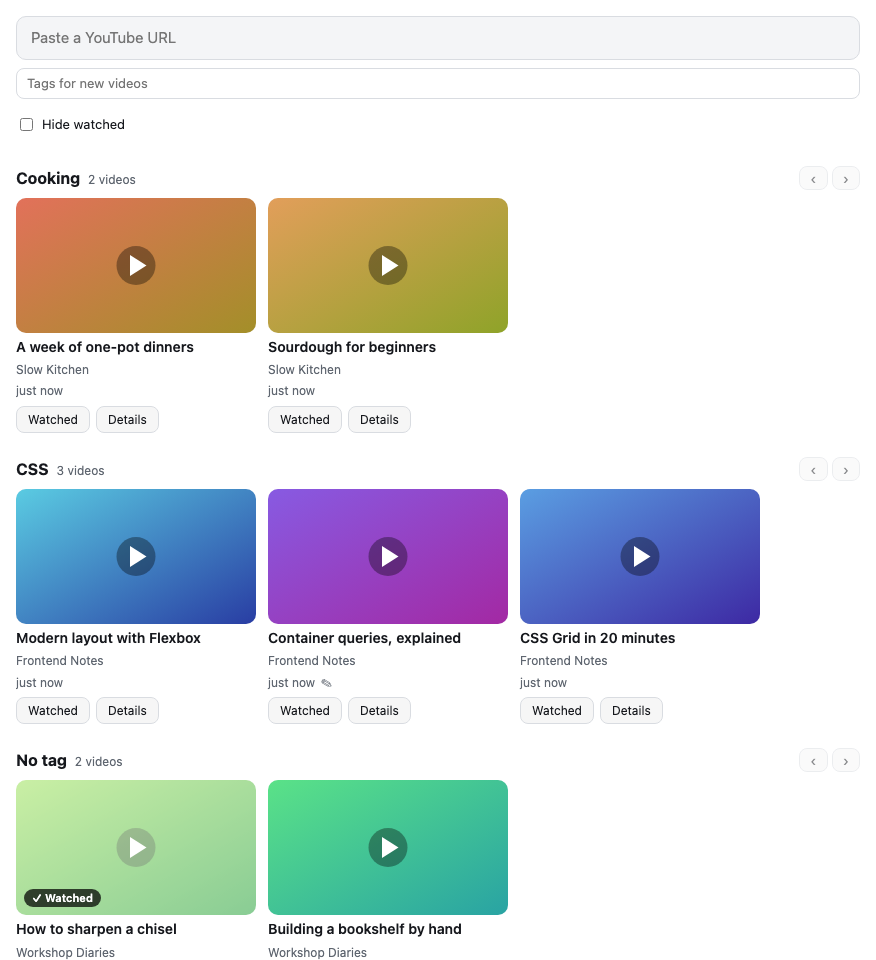
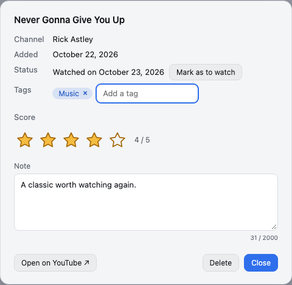
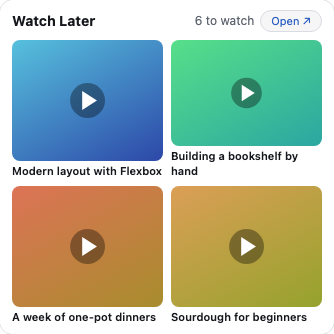

# Watch Later

**Keep the YouTube videos you want to watch later: paste or drop a link, sort them by tag, and find those you have not watched yet.**

Every change is saved the moment you make it. There is no Save button.

## Adding a video

Copy the link of a YouTube video, then paste it in the field at the top of the page and press **Enter**, or paste it anywhere on the page with **Ctrl+V** (**Cmd+V** on a Mac). You can also drag a link onto the page, from a browser tab, the address bar or another page, and drop it where it says **Drop to add**. Links to a video, a Short, a live stream or an embedded player are all recognized, and so is the moment a link starts at.

The video appears at once with its thumbnail, then with its title and its channel, read from YouTube. If YouTube cannot be reached, the link stands in for the title: click **Retry** to read it again.

### Several videos at once

Paste or drop several links at once, one per line, and they are all added: the page then says how many were added, how many were already there and how many were not videos.

A video is never added twice: if it is already in your list, even from another link or at another moment, the page shows its card instead.

## Tags and rows

Tags sort your videos by theme. In the details of a video, type a tag in **Add a tag** and press **Enter**, or just leave the field; the tags you already use are suggested as you type, and picking one adds it. Click the **×** of a tag to take it off. Tags ignore case and extra spaces: `music` and ` Music ` are the same tag, written as you first wrote it.

To tag videos as you add them, choose tags in **Tags for new videos**, under the field: every video you add next gets them, until you close the page.

The page shows one row per tag, in alphabetical order, then a **No tag** row for the videos without one. A video with two tags is in both rows. Each row says how many videos it holds and scrolls sideways: with a trackpad, with **Shift** and the mouse wheel, with a finger, or with the **‹ ›** buttons. The page itself scrolls from one tag to the next. Among videos still to watch, those you have never placed come first, newest first, followed by those you placed in their saved order. Each card says when you added it.

To sort your tags in two levels, write a group before the tag, with a slash: `Music/Jazz` is the tag **Jazz** of the group **Music**. A group is a section of the page, with one row per tag of the group; a tag `Music` of its own is its first row. Click the name of a group to fold or unfold it: the page remembers the groups you folded.

### Moving a video

Drag a card with the mouse to put it elsewhere. Drag-and-drop only sets the order of videos still to watch: a bar shows where one will land. Dropped in its own row, it changes place, and the row keeps the order you gave it; videos you add next come first, before those you placed. Dropped among watched videos, it goes first among those still to watch.

Dropped in another row, a video leaves the tag of its row for the tag of the other one, and keeps its other tags. A watched video can change rows too, but its score decides its position; dropping it in its own row does not move it. A video with other tags cannot go to **No tag**: take them off in its details first.

### Moving a row or a group

Drag a row by its header, or a group by its name, to put it above or below another: a bar shows where it will land, depending on whether you drop on the upper or lower half of the other section. The rows of a group move among themselves, inside the group. The page remembers the order you gave; a new tag comes after the sections you placed.

### Deleting a whole section

Point at the header of a row, or at the name of a group, and click **Delete** to delete all its videos at once, the watched ones too, even when they are hidden. The page asks you to confirm first, and tells you how many videos go. A video that is also in other sections leaves them too, since it is deleted from your list.

## Watching

Click the thumbnail or the title of a video to open it on YouTube, in a new tab. Videos play on YouTube rather than in Tessello: Tessello does not let a Module embed another site's page, not even YouTube's player.

Once you have watched a video, click **Watched** on its card, or **Mark as watched** in its details. A dialog asks for a required score from **0 to 5** and an optional **Note**, filled with your existing note so you can correct it. Click a star to choose a score; clicking the selected star removes one star, including the last one for **0 / 5**. You can also focus the score with the keyboard and use the arrow keys. **Mark as watched** stays disabled until you choose a score. **Cancel**, **Escape** or clicking outside the dialog leaves the video unchanged.

**Hide watched**, at the top of the page, is on at first: a video you mark as watched then leaves the page, and **Undo**, in the message that follows, restores its previous status and note. Uncheck **Hide watched** to see every video, the watched ones dimmed and marked **✓ Watched**, with their score in stars. Every row, including rows inside groups and **No tag**, starts with watched videos from score **5** down to **0**, then older watched videos without a score. At the same score, the most recently watched comes first. Videos still to watch follow in their own order. The page remembers your choice.

Change a watched video's score in **Details**; the new score is saved at once and updates its position. Click **✓ Watched** on the card, or **Mark as to watch** in the details, to put it back among those to watch without a dialog. This forgets its score and watched date, and keeps its note. Its previous manual position is reused if still saved; otherwise it comes among the never-placed videos.

## Notes and deleting

Click **Details** on a card, or anywhere on the card but its title and thumbnail, to see its channel, when you added it and whether you watched it, and to mark it as watched or to watch.

Write in **Note** why you kept the video, up to 2,000 characters: the note is saved when you leave the field or close the details, and a ✎ on the card tells you it has one.

**Delete** removes the video from your list once you confirm it. A deleted video cannot be brought back, but you can add it again from its link.

## On the Home

The Watch Later Widget says how many videos are left to watch and shows the four you added last. Click one to open it on YouTube, or click **Open ↗** to come to this page. When nothing is left to watch, **+ Add** brings you here to add a video.

## When something goes wrong

- **Your videos could not be read**: Tessello could not read what the Module saved. Nothing can be added until they are read, so that an empty list never replaces yours. Click **Try again**.
- **Your last change could not be saved**: the change is still on screen, but it will be lost when you leave. If the message says the storage is full, the Module holds more than Tessello allows it: delete videos, or shorten long notes.
- **This video is already in your list**: the video you pasted or dropped is there already; its card is highlighted a moment.
- **This is not a YouTube video**: what you pasted or dropped is not a link to a YouTube video, so nothing was added.
- **A link instead of a title, with Retry**: YouTube could not be reached, or the video is private. The video is kept all the same; click **Retry** once you are back online.
- **Thumbnails missing**: you are offline, or YouTube cannot be reached. Your list, its titles, tags and notes are all still there; the thumbnails come back with the network.

## Your data

Your videos, their scores, tags and notes, and the choice to hide the watched ones are saved in your Tessello space, on your computer, and nowhere else.

The Module asks for two Permissions when you install it, both to reach YouTube and nothing else:

- `https://www.youtube.com`, to read the title and channel of a video, once, when you add it. YouTube gets the link of that video, as it would if you opened it.
- `https://i.ytimg.com`, where YouTube keeps the thumbnails, to show them.

Uninstalling the Module deletes your videos.

## About Watch Later

Watch Later is a Module of [Tessello](https://github.com/craftskillz/tessello), published by @craftskillz under the MIT license. Its sources, its versions and its issues are at https://github.com/craftskillz/tessello-watch-later.
